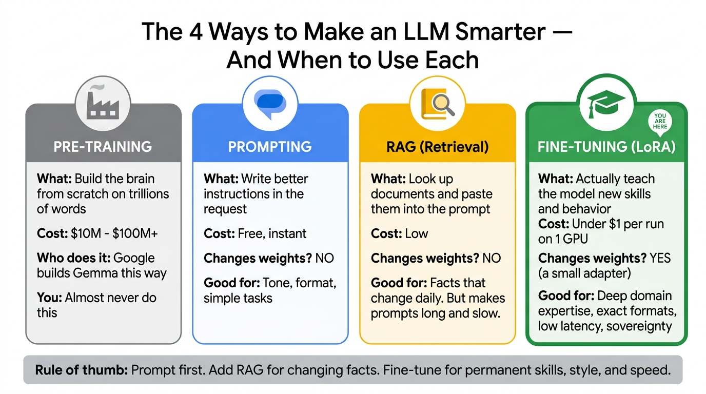
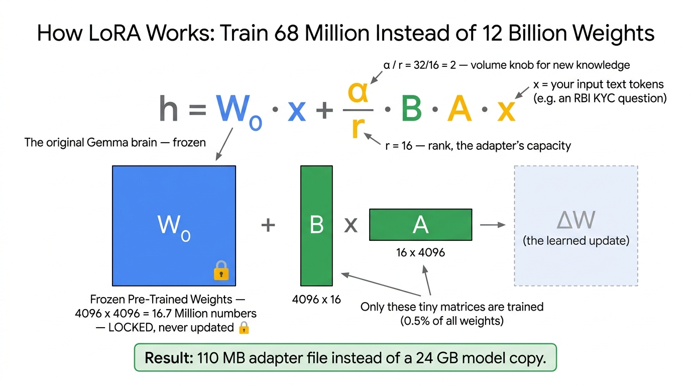
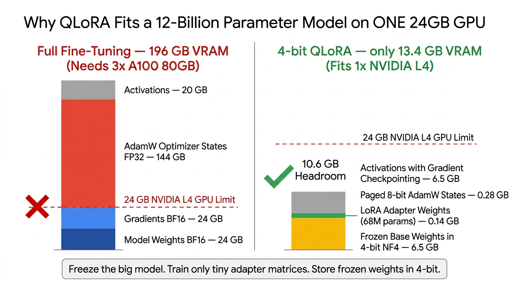

# Module 0: Generative AI & Fine-Tuning Fundamentals — A Ground-Up Primer

> **Who this is for**: Cloud Architects, Engineers, and Customer Engineers who are **new to Machine Learning and Generative AI**. No prior data science, statistics, or PyTorch experience is assumed.
>
> **Promise**: By the end of this document you will understand *what a token is*, *what a weight is*, *what actually changes during fine-tuning*, and you will be able to read and explain **every single equation** used in this bootcamp — line by line, symbol by symbol.

---

## Table of Contents
1. [Part 1: What Is a Large Language Model, Really?](#part-1-what-is-a-large-language-model-really)
2. [Part 2: The Four Ways to Make a Model Smarter (And Why We Chose Fine-Tuning)](#part-2-the-four-ways-to-make-a-model-smarter-and-why-we-chose-fine-tuning)
3. [Part 3: What Actually Happens During Training — Explained Without Jargon](#part-3-what-actually-happens-during-training--explained-without-jargon)
4. [Part 4: Every Equation in This Bootcamp, Explained Symbol by Symbol](#part-4-every-equation-in-this-bootcamp-explained-symbol-by-symbol)
5. [Part 5: The Complete Glossary of Terms You Will Hear](#part-5-the-complete-glossary-of-terms-you-will-hear)
6. [Part 6: Common Beginner Mistakes & How to Debug Them](#part-6-common-beginner-mistakes--how-to-debug-them)

---

## Part 1: What Is a Large Language Model, Really?

### 1.1 A Model Is Just a Very Large Pile of Numbers

When you download `google/gemma-4-12B-it`, you are downloading a folder of files totaling about **24 Gigabytes**. Inside those files is essentially one thing: **a gigantic list of decimal numbers**.

- `gemma-4-12B-it` contains roughly **12,000,000,000 (12 billion) numbers** (and its compact sibling `gemma-4-E4B-it` has ~4 billion effective parameters).
- Each of those numbers is called a **parameter** or a **weight**.
- Each number is typically stored in **16 bits** (2 bytes) of memory. That's why: $12 \times 10^9 \text{ numbers} \times 2 \text{ bytes} = 24 \text{ GB}$.

A weight is just a number like `0.0281` or `-0.5573`. On its own it means nothing. Collectively, arranged into grids called **matrices**, they encode everything the model "knows" about language, reasoning, code, and facts.

> [!NOTE]
> **Analogy**: Think of a giant mixing desk in a music studio with 12 billion tiny volume sliders. Each slider is a weight. Training is the process of nudging every slider until the sound coming out is exactly what you want. "Fine-tuning" is nudging a small subset of those sliders to change the style of music.

### 1.2 Tokens — How the Model Sees Text

A model cannot read letters. Before anything happens, your text is chopped into **tokens** by a component called the **tokenizer**.

A token is a common chunk of text — sometimes a whole word, sometimes part of a word:

| Your Text | How Gemma Tokenizes It | Token Count |
| :--- | :--- | :--- |
| `"The bank must refund ₹100 per day"` | `["The", " bank", " must", " refund", " ₹", "100", " per", " day"]` | 8 tokens |
| `"RBI/2019-20/67"` | `["RBI", "/", "2019", "-", "20", "/", "67"]` | 7 tokens |
| `"Unincorporated"` | `["Un", "incorpor", "ated"]` | 3 tokens |

**Practical rule of thumb**: 1 token ≈ 0.75 English words ≈ 4 characters. Our Indian FSI training examples average **383 tokens** each.

Gemma's tokenizer has a **vocabulary of 256,000 tokens** — unusually large. This matters for India: the symbol `₹`, and words like `Crore`, `Lakh`, `IFSC`, `Aadhaar` exist as compact single tokens rather than being shattered into individual letters, which makes Gemma noticeably better at Indian financial text than many competing open models.

### 1.3 What the Model Actually Does: Predict the Next Token

This is the single most important idea in all of Generative AI, and it's shockingly simple:

> **A Large Language Model does exactly one thing: given a sequence of tokens, it predicts a probability score for what the very next token should be.**

Given the input `"The capital of India is"`, the model outputs a probability for **every one of the 256,000 tokens** in its vocabulary:

| Candidate Next Token | Probability |
| :--- | :--- |
| `" New"` | 0.81 |
| `" Delhi"` | 0.11 |
| `" Mumbai"` | 0.04 |
| `" a"` | 0.01 |
| ...255,996 others... | ~0.03 total |

The system picks a token (usually the highest probability one), appends it to the input, and **runs the whole thing again** to get the next token. Repeat until the model emits a special `<end_of_turn>` stop token. That loop is called **autoregressive generation** — and it is 100% of what "the AI is writing an answer" means.

> [!IMPORTANT]
> **Everything in fine-tuning flows from this fact.** When we "teach Gemma Indian banking regulations," what we are literally doing is adjusting weights so that after the tokens `"The RBI turnaround time compensation is ₹"`, the token `"100"` gets a high probability instead of `"10"` or `"50"`.

### 1.4 Base Models vs. Instruct Models (`-it`)

You will see two flavors of every Gemma release:

| Model Name | Meaning | Behavior |
| :--- | :--- | :--- |
| `google/gemma-4-12B` | **Base / Pre-trained** | Pure text autocomplete. Ask it a question and it may just generate 10 more similar questions. Not conversational. |
| `google/gemma-4-12B-it` | **Instruction-Tuned** (`it`) | Google already fine-tuned it to follow instructions and behave like a helpful assistant. **Always start here.** |

We always fine-tune the **`-it`** variant, because we want to *add* Indian FSI expertise on top of existing conversational ability — not rebuild conversation from scratch.

### 1.5 The Gemma Chat Template — Why Those Weird `<start_of_turn>` Tags Matter

An instruct model was trained to expect a very specific text format. If you don't match it exactly, quality collapses. Gemma's format is:

```text
<start_of_turn>user
You are a Principal Financial Regulatory AI Assistant...

What is the UBO threshold for a Private Limited Company?<end_of_turn>
<start_of_turn>model
The statutory UBO threshold is 10% under...<end_of_turn>
```

Three things to note:
1. `<start_of_turn>` and `<end_of_turn>` are **special control tokens**, not literal text. The tokenizer converts each into a single token ID.
2. Gemma 2/3 has **no separate `system` role**. Your system instructions must be prepended inside the first `user` turn. (This is exactly what our [`data/generate_fsi_dataset.py`](../data/generate_fsi_dataset.py) does in the `format_gemma_chat()` function.)
3. During training, the model learns to produce everything after `<start_of_turn>model` — that is the part we are actually teaching.

---

## Part 2: The Four Ways to Make a Model Smarter (And Why We Chose Fine-Tuning)



### 2.1 The Decision Framework

| Approach | What Changes? | Cost | Latency Impact | When to Use It |
| :--- | :--- | :--- | :--- | :--- |
| **Pre-Training** | All 12B weights, from random noise | $10M – $100M+ | N/A | Only frontier labs (Google builds Gemma this way). You will never do this. |
| **Prompting** | Nothing. Just the input text. | Free | Neutral | Tone tweaks, simple formatting, quick experiments. **Always try this first.** |
| **RAG (Retrieval-Augmented Generation)** | Nothing. You paste retrieved documents into the prompt. | Low | **Worse** — long prompts mean slower responses | Facts that change daily (today's interest rate, this customer's balance). |
| **Fine-Tuning (LoRA / QLoRA)** | A small set of new adapter weights | **< $1 per run on 1 GPU** | **Better** — short prompts, fast responses | Permanent skills, deep domain expertise, strict output formats, regulated behavior, sovereignty. |

### 2.2 Why Fine-Tuning Specifically Wins for Indian FSI

Our [`evaluation/hillclimbing_simulator.py`](../evaluation/hillclimbing_simulator.py) demonstrates this empirically:

- **RAG only (`v1`)** got citation recall to 62%, **but inflated Time-to-First-Token from 22ms to 85ms** (a 3.8x latency penalty) because every request had to carry thousands of tokens of RBI circular text. For a UPI dispute system processing millions of transactions, that latency is fatal.
- **Fine-tuning (`v2`–`v5`)** pushed accuracy to 99.9% **while returning latency to ~17–23ms**, because the knowledge now lives *inside the weights* instead of being re-pasted into every prompt.

> [!TIP]
> **The professional answer is usually "both"**: Fine-tune for *skills, format, and reasoning patterns* (how to structure an FIU-IND STR runbook), and use RAG for *volatile facts* (today's repo rate). This bootcamp teaches the fine-tuning half.

---

## Part 3: What Actually Happens During Training — Explained Without Jargon

Here is the complete training loop. Every fine-tuning framework on earth — including our [`training/train_gemma_qlora.py`](../training/train_gemma_qlora.py) — does exactly these 6 steps, over and over.

```text
For each batch of training examples:
   Step 1. FORWARD PASS   → Feed the example in; model predicts next tokens
   Step 2. LOSS           → Measure how wrong the predictions were (one number)
   Step 3. BACKWARD PASS  → Work out which weights caused the wrongness (gradients)
   Step 4. OPTIMIZER STEP → Nudge those weights slightly in the right direction
   Step 5. SCHEDULER STEP → Adjust how big the next nudge will be
   Step 6. REPEAT
```

### Step 1 — The Forward Pass
We feed the model the token sequence for a training example, e.g. an RBI KYC question plus its correct answer. The model produces a probability distribution for each next token. Nothing is learned yet; we are just seeing what it currently believes.

### Step 2 — The Loss (Cross-Entropy)
We compare the model's predictions against the *actual* next tokens in our training example. The mismatch is summarized in **one single number called the loss**.

- A loss of `3.5` means "very wrong, confidently predicting the wrong tokens."
- A loss of `0.4` means "usually predicting the right token."
- **Your entire job as a fine-tuner is to make this number go down** — without making it go down *too far* (which means memorizing rather than learning; see overfitting below).

### Step 3 — The Backward Pass (Backpropagation & Gradients)
The framework calculates, for every trainable weight, **"if I increased this specific weight a tiny bit, would the loss go up or down, and by how much?"** That answer is called a **gradient**.

> **Analogy**: You're standing on a foggy hillside and want to reach the valley floor (minimum loss). You can't see the valley, but you *can* feel the slope under your feet. The gradient is that slope. Backpropagation is feeling the slope for all 68 million adapter weights simultaneously.

### Step 4 — The Optimizer Step (AdamW)
The optimizer takes the gradients and actually moves the weights. We use **AdamW**, which is smarter than plain gradient descent because it remembers momentum (which direction we've been heading) and adapts the step size per-weight.

### Step 5 — The Scheduler
The **learning rate** (how big each step is) is not constant. We *warm it up* gently for the first 5% of steps, then *decay it* along a cosine curve toward zero. See the equations section for exactly why.

### Underfitting vs. Overfitting — The Central Tension

| Symptom | What You See in the Logs | What It Means | How to Fix |
| :--- | :--- | :--- | :--- |
| **Underfitting** | Training loss stays high (e.g. > 1.5) and barely moves | Model hasn't learned the domain. Adapter too small or training too short. | Increase `lora_r` (16 → 32), add more `target_modules`, train more epochs, raise learning rate. |
| **Good Fit** | Training loss drops **and** validation loss drops with it | The model genuinely learned generalizable rules. | Ship it. |
| **Overfitting** | Training loss keeps dropping, but **validation loss starts rising** | Model is memorizing your 1,200 training examples verbatim instead of learning the underlying regulation. | Fewer epochs, add `lora_dropout`, more/more-varied training data, lower `lora_r`. |

> [!IMPORTANT]
> This is precisely why our [`data/generate_fsi_dataset.py`](../data/generate_fsi_dataset.py) splits data into **Train (1,200) / Validation (150) / Test (150)** with **zero overlap**, and why [`data/inspect_dataset.py`](../data/inspect_dataset.py) verifies that overlap is exactly `0`. The validation set is your early-warning system for overfitting. The test set is held back entirely until the very end so your final score is honest.

---

## Part 4: Every Equation in This Bootcamp, Explained Symbol by Symbol

This is the section to read slowly. Each equation is broken into: *what it says in English*, *what each symbol means*, *a worked numeric example*, and *why you should care*.

---

### Equation 1 — The LoRA Adapter (The Heart of Everything)



$$h = W_0 x + \frac{\alpha}{r} B A x$$

**In plain English**: "The output equals what the original frozen model would have said, **plus** a small correction learned by two tiny new matrices, scaled by a volume knob."

**Symbol-by-symbol:**

| Symbol | Name | What It Actually Is | Size in Gemma-3-12B |
| :--- | :--- | :--- | :--- |
| $x$ | **Input activation** | The vector of numbers representing your input tokens as they flow into this layer | A vector of ~4,096 numbers |
| $W_0$ | **Frozen base weight matrix** | The original pre-trained Gemma weights for this layer. **We never touch these.** | 4,096 × 4,096 = 16.7 million numbers |
| $h$ | **Output (hidden state)** | The result passed to the next layer | A vector of ~4,096 numbers |
| $A$ | **LoRA "down-projection"** | A new, trainable skinny matrix. Initialized with small random Gaussian noise. | 16 × 4,096 = 65,536 numbers |
| $B$ | **LoRA "up-projection"** | A new, trainable skinny matrix. **Initialized to all zeros.** | 4,096 × 16 = 65,536 numbers |
| $r$ | **Rank** | The thin waist of the bottleneck. How much new capacity the adapter has. | We use `r = 16` |
| $\alpha$ | **Alpha (scaling factor)** | The "volume knob" for how loudly the adapter speaks | We use `alpha = 32` |

**Why is $B$ initialized to zero?** Because $B = 0$ makes $BA = 0$, so at training step 0 the equation collapses to $h = W_0 x$ — **exactly the original model, unchanged**. This guarantees fine-tuning starts from a known-good state and improves from there, rather than immediately damaging the model with random noise.

**Worked numeric example:**
- Full weight matrix $W_0$: $4{,}096 \times 4{,}096 = 16{,}777{,}216$ numbers.
- LoRA matrices: $B$ is $4{,}096 \times 16 = 65{,}536$, plus $A$ is $16 \times 4{,}096 = 65{,}536$. Total = $131{,}072$ numbers.
- **Ratio**: $131{,}072 \div 16{,}777{,}216 = 0.78\%$. We train less than 1% as many numbers.
- Scaling factor: $\frac{\alpha}{r} = \frac{32}{16} = 2$. The adapter's correction is amplified 2×.

**Why it works at all (the key insight)**: Researchers discovered that the *change* a model needs in order to specialize into a new domain is "low rank" — meaning it can be compressed into a few directions. You don't need 16.7 million degrees of freedom to teach Gemma about RBI circulars. You need about 131,072.

---

### Equation 2 — Full Fine-Tuning Memory (Why We Can't Just Train Everything)



$$\text{VRAM}_{\text{full}} = \underbrace{2\Phi}_{\text{weights}} + \underbrace{2\Phi}_{\text{gradients}} + \underbrace{12\Phi}_{\text{AdamW states}} + \underbrace{\text{Activations}}_{\approx 20\text{GB}}$$

**In plain English**: "To train every weight normally, the GPU must hold four separate things in memory at the same time, and the optimizer's bookkeeping is by far the biggest."

**Symbol-by-symbol:**

| Term | Why That Multiplier? |
| :--- | :--- |
| $\Phi$ | The number of parameters. For Gemma-3-12B, $\Phi = 12 \times 10^9$. |
| $2\Phi$ (weights) | Each weight stored in `bfloat16` = **2 bytes**. |
| $2\Phi$ (gradients) | Every trainable weight needs its own gradient, also 2 bytes. |
| $12\Phi$ (optimizer) | AdamW keeps **three** FP32 (4-byte) copies per weight: a master weight, the momentum $m_t$, and the variance $v_t$. $3 \times 4 = 12$ bytes. |
| Activations | Intermediate results saved during the forward pass so the backward pass can use them. Grows with sequence length and batch size. |

**Worked calculation for Gemma-3-12B:**
$$(2 \times 12\text{B}) + (2 \times 12\text{B}) + (12 \times 12\text{B}) + 20\text{GB} = 24 + 24 + 144 + 20 = \mathbf{212\ \text{GB}}$$

**Why you care**: A single NVIDIA L4 has **24 GB**. A single A100 has **80 GB**. Full fine-tuning Gemma-3-12B needs **3 or more A100s** networked together — roughly **$10+ per run** and significant orchestration complexity. That is the problem QLoRA solves.

---

### Equation 3 — QLoRA Memory (Why 13.4 GB Fits on One L4)

$$\text{VRAM}_{\text{QLoRA}} = \underbrace{0.55\Phi}_{\text{4-bit frozen weights}} + \underbrace{2\Phi_{\text{LoRA}}}_{\text{adapter}} + \underbrace{4\Phi_{\text{LoRA}}}_{\text{8-bit paged AdamW}} + \underbrace{\text{Activations}}_{\approx 6.5\text{GB w/ checkpointing}}$$

**The three tricks that make this work:**

**Trick 1 — 4-bit NormalFloat (NF4) Quantization.**
We compress each frozen weight from 16 bits down to ~4.5 bits (4 bits + a small amount for the shared scaling factors after double-quantization). So $\Phi \times 0.55$ bytes instead of $\Phi \times 2$ bytes.

*Why "NormalFloat" and not just plain 4-bit integers?* Neural network weights are not spread out evenly — when you plot them, they form a **bell curve (normal distribution)** clustered tightly around zero. Plain `int4` would space its 16 available buckets evenly, wasting most of them on the empty tails. NF4 instead places its 16 buckets so that **an equal number of actual weights land in each bucket** — information-theoretically optimal for bell-curve data. The result: 4× compression with almost no measurable accuracy loss.

**Trick 2 — Only the adapter has gradients and optimizer state.**
$\Phi_{\text{LoRA}} \approx 68$ million, not 12 billion. So the gradient and optimizer costs are **176× smaller**.

**Trick 3 — Gradient Checkpointing.**
Instead of saving every intermediate activation during the forward pass, we throw most of them away and **recompute them on demand** during the backward pass. This trades about **+15–20% training time** for about **−60% activation memory**, reducing activations from ~20 GB to ~6.5 GB.

**Worked calculation for Gemma-3-12B with `r=16`:**
$$6.5 + 0.14 + 0.28 + 6.5 = \mathbf{13.4\ \text{GB}} \quad \text{— fits in a 24 GB L4 with 10.6 GB to spare.}$$

---

### Equation 4 — The AdamW Optimizer Update Rule

$$\theta_{t+1} = \theta_t - \eta \cdot \frac{\hat{m}_t}{\sqrt{\hat{v}_t} + \epsilon}$$

**In plain English**: "The new value of each weight equals its old value, minus a step whose size depends on the learning rate, the recent average direction of travel, and how noisy that direction has been."

**Symbol-by-symbol:**

| Symbol | Name | Intuitive Meaning |
| :--- | :--- | :--- |
| $\theta_t$ | Weight at step $t$ | The current value of one LoRA adapter number |
| $\theta_{t+1}$ | Weight at next step | The updated value after this batch |
| $\eta$ (eta) | **Learning rate** | The base step size. We use `2e-4` = `0.0002`. |
| $\hat{m}_t$ | **First moment (momentum)** | A running average of recent gradients. Acts like inertia — if we've been consistently rolling downhill in one direction, keep going that way. Smooths out noisy individual batches. |
| $\hat{v}_t$ | **Second moment (variance)** | A running average of recent *squared* gradients. Measures how erratic this particular weight's gradient has been. |
| $\epsilon$ (epsilon) | Tiny constant (e.g. $10^{-8}$) | Purely to prevent division by zero. |
| **W** in AdamW | **Decoupled Weight Decay** | A separate gentle pull of every weight toward zero, which discourages any single weight from growing huge. Our setting: `weight_decay=0.01`. |

**The clever part — adaptive per-weight steps:** Notice we divide by $\sqrt{\hat{v}_t}$. If a particular weight's gradient has been swinging wildly (high variance), $\hat{v}_t$ is large, so we divide by a big number and take a **small, cautious step**. If a weight's gradient has been stable and consistent, $\hat{v}_t$ is small, so we take a **larger, confident step**. Every one of the 68 million adapter weights gets its own personalized step size, automatically.

**Why "paged_adamw_8bit" in our config?** Two optimizations: (a) store $m_t$ and $v_t$ in 8-bit instead of 32-bit, saving 75% of optimizer memory; (b) "paged" means if the GPU briefly runs out of memory during a spike, CUDA Unified Memory automatically shuttles optimizer state out to CPU RAM instead of crashing with `CUDA Out Of Memory`.

---

### Equation 5 — Cosine Learning Rate Schedule with Warmup

$$
\eta_t =
\begin{cases}
\eta_{\max} \cdot \dfrac{t}{T_{\text{warmup}}} & \text{if } t < T_{\text{warmup}} \quad \text{(linear warmup)} \\[2ex]
\dfrac{\eta_{\max}}{2}\left(1 + \cos\left(\pi \cdot \dfrac{t - T_{\text{warmup}}}{T_{\text{total}} - T_{\text{warmup}}}\right)\right) & \text{otherwise} \quad \text{(cosine decay)}
\end{cases}
$$

**In plain English**: "Start at almost zero speed, ramp up smoothly to full speed over the first 5% of training, then gradually slow down following a smooth cosine curve until you're crawling at the very end."

**Symbol-by-symbol:**

| Symbol | Meaning | Our Value |
| :--- | :--- | :--- |
| $\eta_t$ | The learning rate at step $t$ | Varies |
| $\eta_{\max}$ | Peak learning rate | `2e-4` |
| $t$ | Current training step | 0 → 225 |
| $T_{\text{warmup}}$ | Steps spent warming up | `0.05 × 225 ≈ 11 steps` |
| $T_{\text{total}}$ | Total training steps | 225 (see Equation 6) |

**Why warmup?** At step 0, AdamW's momentum $\hat{m}_t$ and variance $\hat{v}_t$ estimates are based on almost no data — they're essentially garbage. If you take full-size steps using garbage estimates, you can violently corrupt the carefully pre-trained attention heads in the first few batches. Warmup takes tiny steps until the estimates become trustworthy.

**Why cosine decay?** Early in training you want big steps to find the right neighborhood quickly. Late in training you want tiny steps to settle precisely into the bottom of the valley rather than bouncing back and forth over it. The cosine curve gives a smooth, gentle transition between the two, with no abrupt jumps.

---

### Equation 6 — Effective Batch Size & Step Count

$$\text{Effective Batch Size} = \text{batch\_size} \times \text{grad\_accum} \times \text{num\_gpus}$$
$$\text{Total Steps} = \frac{\text{Training Examples} \times \text{Epochs}}{\text{Effective Batch Size}}$$

**In plain English**: "The GPU can only physically hold 2 examples at a time, so we process 2, remember the gradients, process 2 more, remember again — 8 times — and only *then* update the weights. Mathematically this is identical to having processed 16 examples at once."

**Worked calculation for our bootcamp:**
- Effective Batch Size = $2 \times 8 \times 1 = \mathbf{16}$
- Total Steps = $\dfrac{1{,}200 \text{ examples} \times 3 \text{ epochs}}{16} = \dfrac{3{,}600}{16} = \mathbf{225 \text{ optimizer steps}}$

**Definitions you need:**
- **Epoch**: One complete pass over your entire training dataset. 3 epochs means the model sees each of the 1,200 examples three times.
- **Step (or iteration)**: One weight update. Our run does 225 of them.
- **Why not just use `batch_size=16` directly?** Because 16 examples × 2,048 tokens of activations would blow past 24 GB of VRAM and crash. Gradient accumulation gives you the *statistical stability* of a big batch at the *memory cost* of a tiny one. This is the single most useful memory trick in all of fine-tuning.

> [!TIP]
> **Golden rule**: If you double `batch_size`, halve `grad_accum` to keep the effective batch size (and therefore the training dynamics) identical. Effective batch size below 4 gives noisy, unstable gradients; above 64 on a small dataset wastes time.

---

### Equation 7 — Gemma's Attention Logit Soft-Capping (Why `bfloat16` Is Mandatory)

$$\text{logits}_{\text{capped}} = c \cdot \tanh\left(\frac{\text{logits}}{c}\right)$$

**In plain English**: "Before deciding which words to pay attention to, squash any extreme attention scores smoothly back into a safe range, so no single token can dominate and destabilize the math."

**Symbol-by-symbol:**

| Symbol | Meaning |
| :--- | :--- |
| $\text{logits}$ | Raw attention scores before the softmax — can be any size, positive or negative |
| $c$ | The soft-cap ceiling. Gemma uses `50.0` for attention layers, `30.0` for the final output layer. |
| $\tanh$ | The hyperbolic tangent function. It smoothly squeezes any input into the range $(-1, +1)$. |

So $c \cdot \tanh(\text{logits}/c)$ smoothly squeezes everything into the range $(-c, +c)$ — a "soft" ceiling, as opposed to a hard clip that would create a non-differentiable kink and break gradient flow.

> [!CAUTION]
> **This is the #1 Gemma-specific trap for beginners.** You must set `bnb_4bit_compute_dtype=torch.bfloat16`, **never** `torch.float16`.
>
> - `float16` has a maximum representable value of about **65,504**. Intermediate values inside the $\tanh$ derivative during backpropagation can exceed this, producing `inf`, which then becomes `NaN`, which silently poisons every weight in the model. Your loss suddenly prints `nan` and the run is dead.
> - `bfloat16` sacrifices some decimal precision but keeps the **exact same exponent range as 32-bit float** (max ≈ $3.4 \times 10^{38}$). It cannot overflow here.
> - Both NVIDIA **L4 (Ada Lovelace)** and **A100 (Ampere)** GPUs have native `bfloat16` Tensor Cores, so there is zero speed penalty. Older **T4 (Turing)** GPUs lack native bf16 — this is another reason our notebook auto-selects a smaller model on T4.

---

### Equation 8 — Merging the Adapter Back In (For Fast Serving)

$$W_{\text{merged}} = W_0 + \frac{\alpha}{r} B A$$

**In plain English**: "Once training is done, actually do the addition once and bake the result into a new set of weights, so that at inference time there's no extra math to perform."

**Why bother?** During training we keep $W_0$, $B$, and $A$ separate so we can update $B$ and $A$. But during inference that means every single layer does *two* matrix multiplications instead of one. By computing $W_0 + \frac{\alpha}{r}BA$ **once** and saving the result, inference becomes exactly as fast as the original model — zero adapter overhead.

This is what the `--merge-weights` flag does in [`training/train_gemma_qlora.py`](../training/train_gemma_qlora.py), producing a standalone `merged_model_bf16/` folder of `.safetensors` files ready for vLLM.

**The trade-off:**

| Approach | Serving Speed | Flexibility | Best For |
| :--- | :--- | :--- | :--- |
| **Merged** (`--merge-weights`) | Fastest | One model = one specialty | A single sovereign FSI endpoint |
| **Unmerged adapters** (keep $B$, $A$ separate) | ~5% slower | vLLM can hot-swap between many 110 MB adapters on one loaded base model | A bank serving 5 departments (KYC, Lending, Treasury, UPI Ops, Wealth) from **one** GPU |

---

### Equation 9 — The Evaluation Composite Score

$$S_{\text{composite}} = 0.40 \cdot R_{\text{citation}} + 0.40 \cdot P_{\text{numeric}} + 0.20 \cdot F_1$$

**In plain English**: "A single 0–100% score for how good the model is, weighted so that getting the regulation reference right and getting the rupee amount right matter twice as much as sounding fluent."

**Symbol-by-symbol:**

| Symbol | Name | How It's Computed (see [`evaluation/evaluate_fsi_model.py`](../evaluation/evaluate_fsi_model.py)) |
| :--- | :--- | :--- |
| $R_{\text{citation}}$ | **Citation Recall** | Of all the regulatory references in the correct answer (e.g. `RBI/2019-20/67`), what fraction did the model actually produce? Extracted with regex. |
| $P_{\text{numeric}}$ | **Numeric Precision** | Of all the currency amounts and percentages in the correct answer (e.g. `₹6,93,000`, `18.06%`), what fraction did the model get exactly right? |
| $F_1$ | **Token F1 Score** | Harmonic mean of precision and recall over the words used. Measures general structural/textual overlap. |

**Why these weights (0.40 / 0.40 / 0.20)?** Because in banking, **being fluent but wrong is worse than being terse and right.** A model that writes a beautiful paragraph citing the wrong circular fails an RBI inspection. We deliberately down-weight the "sounds nice" metric.

$F_1$ itself is defined as:
$$F_1 = \frac{2 \cdot \text{Precision} \cdot \text{Recall}}{\text{Precision} + \text{Recall}}$$
where **Precision** = "of the words the model said, what fraction were correct?" and **Recall** = "of the words it should have said, what fraction did it say?" The harmonic mean punishes lopsidedness — you can't score well by being verbose (high recall, low precision) or by saying almost nothing (high precision, low recall).

---

### Equation 10 — Bootstrap 95% Confidence Intervals (Is the Improvement Real?)

**The problem it solves**: You test on 150 examples and get 94%. Your colleague retrains and gets 95%. **Is that a genuine improvement, or just luck on which 150 examples you happened to pick?**

**The bootstrap procedure** (implemented in `bootstrap_ci()` in [`evaluation/evaluate_fsi_model.py`](../evaluation/evaluate_fsi_model.py)):

```text
Repeat 1,000 times:
    Draw 150 scores at random FROM YOUR 150 RESULTS, with replacement
    (so some get picked twice, some not at all — this simulates
     "what if I had run a slightly different test set?")
    Record the average of that resample

Sort all 1,000 averages.
The 25th value  = lower bound of the 95% confidence interval
The 975th value = upper bound of the 95% confidence interval
```

**How to read the output:**
```text
RBI_KYC_AML  |  Base: 2.0% [1.9%, 2.0%]  |  Fine-Tuned: 99.9% [99.8%, 100.0%]
```
This says: "We're 95% confident the true Base score is between 1.9% and 2.0%, and the true Fine-Tuned score is between 99.8% and 100.0%."

> [!IMPORTANT]
> **The decision rule**: If the two confidence intervals **do not overlap**, the improvement is statistically real. If they **do overlap**, you may just be seeing noise — do not claim victory, and do not ship. This single discipline prevents the most common failure in applied ML: celebrating random fluctuation.

---

## Part 5: The Complete Glossary of Terms You Will Hear

| Term | Plain-English Definition |
| :--- | :--- |
| **Parameter / Weight** | One of the billions of decimal numbers that make up a model. |
| **Token** | A chunk of text (~4 characters) that the model processes as one unit. |
| **Tokenizer** | The component that converts text ↔ token IDs. Gemma's has a 256K vocabulary. |
| **Embedding** | The conversion of a token ID into a list of numbers (a vector) the math can operate on. |
| **Inference** | Using a trained model to generate an answer. (Opposite of training.) |
| **Forward Pass** | Running input through the model to get predictions. |
| **Backward Pass / Backpropagation** | Calculating which weights contributed to the error. |
| **Gradient** | For a given weight: "which way, and how strongly, should I move this to reduce the loss?" |
| **Loss** | A single number measuring how wrong the model's predictions are. Lower is better. |
| **Epoch** | One full pass over the entire training dataset. |
| **Step / Iteration** | One weight update (after processing one effective batch). |
| **Batch** | A group of examples processed together before updating weights. |
| **Learning Rate** | How big each weight-update step is. |
| **Optimizer** | The algorithm that applies the updates (we use AdamW). |
| **Overfitting** | Memorizing training examples rather than learning general rules. Detected by rising validation loss. |
| **Underfitting** | Failing to learn enough. Detected by stubbornly high training loss. |
| **SFT (Supervised Fine-Tuning)** | Training on labeled (prompt → ideal answer) pairs. What this bootcamp does. |
| **DPO (Direct Preference Optimization)** | Training on (prompt → good answer, bad answer) triplets to align behavior and safety. Used in our `v5` hillclimb step. |
| **PEFT** | Parameter-Efficient Fine-Tuning. The family of techniques (LoRA, prefix tuning, etc.) that train only a small subset of weights. Also the name of the Hugging Face library. |
| **LoRA** | Low-Rank Adaptation. The specific PEFT method we use. |
| **QLoRA** | LoRA applied on top of a 4-bit quantized frozen base model. |
| **Quantization** | Storing numbers with fewer bits (16-bit → 4-bit) to save memory. |
| **NF4** | NormalFloat4. A 4-bit format whose buckets are spaced to match the bell curve of neural weights. |
| **`bfloat16`** | Brain Float 16. A 16-bit number format with FP32's exponent range. Mandatory for Gemma. |
| **VRAM** | Video RAM — the memory physically on the GPU chip. The hard constraint on model size. |
| **Adapter** | The small (~110 MB) file of trained LoRA weights. |
| **Merging** | Folding the adapter into the base weights to make one standalone model. |
| **safetensors** | The modern, safe file format for storing model weights (replaces pickled `.bin`). |
| **Checkpoint** | A saved snapshot of the model partway through training. |
| **Context Window** | Maximum tokens the model can consider at once. Gemma 3/4: 128,000. Gemma 2: 8,000. |
| **KV Cache** | Memory used during generation to avoid recomputing earlier tokens. Grows with context length. |
| **TTFT (Time To First Token)** | How long the user waits before the first word appears. The key latency metric. |
| **vLLM** | A high-performance inference server using PagedAttention to serve many users per GPU. |
| **MoE (Mixture of Experts)** | An architecture where only a fraction of parameters activate per token. Gemma 4 `26b-a4b`: 26B total, 4B active. |
| **Eval** | A structured test suite scoring model quality on specific criteria. |
| **Hillclimbing** | Iteratively changing one variable and re-running evals to systematically improve the score. |
| **Slice** | A subset of the eval set representing one category (e.g. `RBI_KYC_AML`). |
| **Slice Regression** | When the overall score improves but one important category silently gets worse. |
| **Hard Negative** | A deliberately tricky training example designed to fix a specific known failure mode. |
| **CMEK** | Customer-Managed Encryption Key. You own the key in Cloud KMS, not Google. |
| **VPC-SC** | VPC Service Controls. A network perimeter preventing data from leaving your boundary. |

---

## Part 6: Common Beginner Mistakes & How to Debug Them

| Symptom You See | Most Likely Cause | The Fix |
| :--- | :--- | :--- |
| `CUDA out of memory` | Batch size, sequence length, or model too big for your GPU | Lower `--batch-size` to 1 and raise `--grad-accum` to 16 (same effective batch); lower `--max-seq-length` to 1024; or switch to a smaller model (`gemma-3-4b-it`). |
| Loss prints `nan` after a few steps | Using `float16` instead of `bfloat16` with Gemma's soft-capping, **or** learning rate far too high | Set `bnb_4bit_compute_dtype=torch.bfloat16` and `bf16=True`. Drop learning rate to `1e-4`. |
| Loss barely moves (stays ~2.0+) | Underfitting — adapter too small or LR too low | Raise `--lora-r` to 32, confirm all 7 `target_modules` are being targeted, raise LR to `3e-4`, train more epochs. |
| Training loss drops but validation loss rises | Overfitting | Reduce `--epochs` to 1–2, raise `lora_dropout` to 0.1, generate more varied training data. |
| Model outputs run on forever / never stops | Chat template mismatch — the model never learned to emit `<end_of_turn>` | Verify your training text ends with `<end_of_turn>` exactly as in `format_gemma_chat()`. |
| Model answers in a generic way, ignoring your training | Wrong `dataset_text_field`, or the model isn't actually seeing your formatted text | Print one raw training row and confirm it contains the `<start_of_turn>` tags. |
| `403 PERMISSION_DENIED` on the Gemma weights | You haven't accepted the Gemma license on Hugging Face, or `HF_TOKEN` isn't set | Visit the model page on Hugging Face, accept the license, create a read token, then `export HF_TOKEN=hf_...`. |
| `ZONE_RESOURCE_POOL_EXHAUSTED` | No free L4 GPUs in that zone right now | Switch region (`export REGION=asia-southeast1`), fall back to a T4, or use Dynamic Workload Scheduler. See Module 10 in the [main README](../README.md). |
| Great eval score but terrible real-world answers | Your eval set leaked into training, or your eval only measures surface overlap | Re-run [`data/inspect_dataset.py`](../data/inspect_dataset.py) and confirm 0 overlap. Add an LLM-as-a-Judge tier. |

---

## Where to Go Next

1. **Do the hands-on labs**: Follow the [End-to-End Runbook](02_END_TO_END_RUNBOOK.md) — it walks through all 8 steps from Cloud Shell setup to resource cleanup.
2. **Read the architecture theory**: See Modules 1–10 in the [main README](../README.md).
3. **Run the notebook**: Open [`notebooks/Gemma_FSI_Sovereign_FineTuning_Bootcamp.ipynb`](../notebooks/Gemma_FSI_Sovereign_FineTuning_Bootcamp.ipynb) in Vertex AI Colab Enterprise.
